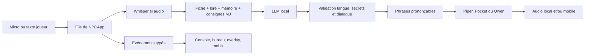

# Architecture de NPC

## Points d'entrée et carte du code

Le paquet Python est dans `src/npc/`. Les ressources `templates/` et `static/`
font partie du paquet installé et se lisent avec `importlib.resources`.

| Fichier ou dossier | Responsabilité |
| --- | --- |
| `cli.py` | Commande `npc` : initialisation, console, diagnostics, import et génération de voix |
| `gui.py`, `desktop.py`, `desktop_worker.py` | Interface Tk, processus moteur isolé, protocole JSON par lignes |
| `app.py` | `NPCApp`, file des commandes, cycle de conversation et décisions du MJ |
| `config.py`, `languages.py` | Réglages TOML, choix des langues et voix, sauvegarde des sélections |
| `roster.py` | Découverte des fiches, résolution des noms, état isolé par PNJ |
| `campaign_import.py` | Adaptateur éditorial pour l'ancien format CampagneBaston |
| `audio/`, `hotkey.py`, `stt.py` | Acquisition, lecture interruptible, raccourcis Linux, Whisper |
| `llm.py` | Clients Ollama et API compatible OpenAI, streaming et reprises limitées |
| `tts.py`, `engines/` | Fabrique partagée ; moteurs Piper, Pocket et Qwen |
| `pocket.py` | Imports de compatibilité vers `engines/pocket.py` |
| `session/` | Historique, prompts, secrets, lore, journaux et découpage en phrases |
| `events.py` | Événements typés et affichage console |
| `overlay.py`, `static/overlay.html` | Affichage OBS et diffusion WebSocket |
| `mobile_server.py`, `mobile_protocol.py`, `static/mobile.html` | Compagnon mobile, commandes et PCM |
| `voice_studio.py`, `voice_design.py` | Histoires et exports WAV, génération depuis TOML/JSON |
| `voice_controls.py` | Validation des réglages du studio, consignes acoustiques et transposition/tempo du PCM |
| `doctor.py` | Contrôles des fichiers, voix, modèles, contexte et périphériques |
| `tests/` | Tests autonomes, tests de services réels et tests Tk optionnels |
| `scripts/` | Sondes manuelles des prompts avec un vrai LLM |

## Un échange

La machine d'états est `IDLE → RECORDING → PROCESSING → SPEAKING`.
Un worker sérialise les tours et les commandes qui modifient les conversations.
Le fil principal gère l'interface ; les callbacks audio copient les échantillons ;
le raccourci global Linux et les serveurs réseau ont leurs propres fils.
Une interruption de parole arrête la lecture via un signal d'annulation.
La synthèse et la lecture utilisent des files bornées pour préparer la suite
sans accumuler toute la réponse avant de parler.

La console envoie le texte brut comme consigne MJ. `/say` et le micro produisent
une parole de joueur. Le bureau transmet ses actions à un processus moteur
séparé par JSON sur stdin/stdout, sans charger les modèles dans Tk.

## Campagnes et isolation

`discover_character_files()` est le point commun de découverte pour le moteur,
les interfaces et les diagnostics. Il accepte `character.md`, `characters/*.md`
et `zones/*/characters/*.md`. La zone `commun` est prioritaire ; les identifiants
de zone sont qualifiés (`village/garde`) pour éviter les collisions.
Les chemins des secrets, du lore et du journal sont fournis par `CharacterFile`.
La disposition complète est présentée dans [README.md](README.md).

`CharacterSlot` porte tout l'état propre à un PNJ : fiche, historique, notes MJ,
journal, tours à résumer, secrets, lore et voix. Changer de PNJ change le slot.
Les résumés et journaux n'assemblent jamais les conversations de plusieurs PNJ.
`/reload` actualise les fichiers et conserve les conversations déjà en mémoire.
Le démarrage, la sélection d'un PNJ et `/reload` ne génèrent aucune réplique.
Le worker attend une parole du joueur, une prise de parole explicite du MJ ou
une livraison de secret approuvé avant de solliciter le modèle de dialogue.

`NPCApp.speak_npc(id, action=None)` soumet une prise de parole MJ ciblée au
même worker. Les actions `presentation`, `fill_wait` et `greeting` sont partagées
par le bureau et le mobile. Le worker sélectionne le slot sans réplique
intermédiaire, puis génère une unique réplique fondée sur sa fiche et le contexte
de sa session. La personnalité, l'attitude et la façon de parler viennent de la
fiche ; aucun ton externe n'est injecté. L'ancien argument `attitude` reste
accepté par l'API Python mais est ignoré et n'entre pas dans la file du worker.
La consigne d'action reste présente lors d'une reprise anti-répétition,
mais n'entre ni dans l'historique ni dans les notes permanentes. Seules les
paroles prononcées sont mémorisées. Le pipeline conserve ses protections de
secrets, sa langue, sa voix attribuée dans la campagne et son annulation audio.
Le bureau transmet l'action JSON `speak_npc` avec `npc` et `speech_action`
(le champ `action` désigne déjà la commande du protocole bureau) ; son sélecteur
reçoit la roster au démarrage, aux changements de PNJ et au rechargement.
Le WebSocket mobile accepte `speak_npc` avec `npc` et `action` uniquement pour
une connexion MJ ; `gm_npc_list.speech_actions` fournit les identifiants et
libellés disponibles. Les anciens champs `attitude` des messages bureau et
mobile sont ignorés. Sans action, le PNJ réagit à la situation actuelle ;
une action inconnue est rejetée avant tout changement de PNJ.
`split_character_speech()` sépare les références Introduction, Meuble et Salutation
du contexte permanent de la fiche, qu'elles soient des puces de métadonnées ou
des sections de niveau 2. `_speak_npc()` ajoute uniquement la référence de l'action
choisie à sa consigne ponctuelle ; `/reload` relit la fiche sans remplacer la mémoire.
Les puces de `## Secrets` restent des confidences locales avec leurs conditions ;
les secrets soumis à autorisation conservent leur fichier et leur filtrage distincts.

Le lore comprend uniquement les fichiers directs `.md`, `.txt`, `.pdf` du dossier
prévu et, pour une zone, son `lore.md` explicite. Les scénarios MJ et les autres
fiches ne sont pas parcourus récursivement. Le chargement d'une roster ou un
contrôle `doctor` partage un cache de lecture : un document de zone est lu et
extrait une seule fois même si plusieurs PNJ l'utilisent. Les `LoreFile` partagés
sont immuables ; les listes et les autres états restent propres à chaque PNJ.
Le cache est recréé à chaque chargement, donc `/reload` prend en compte les
modifications sans conserver d'anciens documents en cache global.

Le prompt conserve une partie stable en tête (règles, fiche, lore) pour faciliter
la réutilisation du contexte par le serveur LLM. Secrets autorisés, mémoire et
notes peuvent changer à chaque tour. `doctor` estime le volume du contexte ;
l'estimation sert à avertir, ce n'est pas un comptage exact de tokens.

Les consignes de dialogue françaises et anglaises demandent de conserver les
rôles de l'échange (propriétaire, prestataire, payeur et bénéficiaire), d'interpréter
les réponses courtes dans ce contexte et de distinguer proposition, accord et
action accomplie. Une réplique antérieure qui inverse ces rôles doit être
rectifiée. Il s'agit d'un guidage du modèle, sans validation sémantique automatique ;
la sonde manuelle `probe_narration.py --coherence` permet d'en examiner les limites.
Elle comprend les transferts d'objets dans les deux sens et les intentions qui
ne doivent pas devenir des dons ou livraisons déjà effectués.

`LlmConfig` expose les réglages facultatifs d'échantillonnage `temperature` et
`top_p` pour les deux backends, ainsi que `top_k` et `repeat_penalty` pour Ollama.
Les clients transmettent les valeurs configurées en mode complet et en streaming,
sans remplacer les valeurs du serveur si elles sont absentes. Le routage des
secrets conserve sa surcharge locale de température à zéro sans modifier le
réglage des dialogues. La fenêtre `num_ctx` reste propre à Ollama.

## Secrets, événements et réseau

Un secret bloqué transmet son thème `hint:`, jamais son corps. L'approbation du
MJ rend le corps disponible pour la réponse. Un refus le retire des thèmes
proposés pendant la session. Les décisions et les journaux sont écrits avec un
fichier temporaire puis `os.replace` ; les transcriptions s'ajoutent par tour.

`NPCApp` émet des événements typés. Les interfaces s'y abonnent ; leurs erreurs
ne doivent pas arrêter une session. Les indicateurs `dm_only` et `table_safe`
guident l'exposition mais les deux serveurs ont des contrats différents :

- L'overlay filtre les événements MJ ; en écoute LAN, il se limite aux événements
  explicitement autorisés pour la table.
- Le protocole joueur mobile applique une liste blanche et exige `table_safe`
  sans `dm_only`, même sur loopback. Les erreurs arbitraires ne sont pas diffusées.
- Le compagnon MJ utilise un canal séparé pour les demandes et décisions de
  secrets. `mobile.secret_approval` vaut `true` par défaut. Sans callback de rôle,
  les connexions sont traitées comme MJ de confiance. Ce réglage doit être
  désactivé pour un accès destiné aux joueurs.

Les fiches mobiles du MJ utilisent deux messages distincts du protocole joueur :
`gm_npc_list` contient seulement les quatre attributs explicites de chaque fiche,
son identité, son état de sélection et le nombre de secrets ; `get_npc_secrets`
retourne `gm_npc_secrets` pour un identifiant exact, uniquement après contrôle du
rôle MJ. La consultation ne change ni le PNJ actif ni les autorisations.
`CharacterSlot.details` est extrait au chargement et à `/reload`, sans parcourir
les scénarios. Les confidences locales (`Cache` ou puces de la section `Secrets`)
s’ajoutent au compteur des secrets soumis à autorisation, avec un statut distinct.
Les corps sont chargés dans le navigateur au clic, effacés au masquage ou à la
déconnexion et ne passent pas par le stockage hors ligne du studio.

La commande mobile MJ `reset_session` appelle `NPCApp.reset_session()` hors de
la boucle réseau. Cette méthode signale l'annulation, arrête la voix et tout
enregistrement local, puis soumet le nettoyage au worker. Celui-ci abandonne
les actions antérieures en attente et les résultats des appels de modèles
encore en cours, prépare de nouveaux `CharacterSlot` avec un cache de lore
limité à ce chargement, puis nettoie les dossiers `session/` et `sessions/`.
`session/reset.py` valide tous les chemins avant suppression et refuse les
liens et points de réanalyse Windows ; il ne parcourt aucun autre dossier de
campagne. Les journaux et autorisations persistants sont conservés.

Pendant ce traitement, le serveur refuse les nouvelles commandes et connexions,
annule le studio vocal et attend sa fin. Il vide les téléversements PCM de tous
les clients et les files de sortie, puis resynchronise l'état et les demandes
MJ. Seul le demandeur reçoit `session_reset`, après réussite des deux pipelines
et du nettoyage. Un échec produit une erreur générique sans exposer de chemin
ni confirmer la réinitialisation. Le client peut réessayer ; une suppression
partielle due à une erreur disque n'est pas restaurée automatiquement.
La tâche de réinitialisation continue si le demandeur se déconnecte ; le
serveur garde les commandes bloquées jusqu'à la fin effective du traitement.

Les serveurs écoutent sur loopback par défaut. Activer l'écoute LAN donne accès
aux appareils du réseau sans authentification par défaut. Les publications audio
observent le PCM déjà synthétisé, sans deuxième synthèse. Les files sortantes
sont bornées et les clients trop lents sont déconnectés.

Les connexions TCP fermées avant l'envoi du moindre octet HTTP sont journalisées
en debug par les serveurs mobile et overlay. Les requêtes HTTP incomplètes ou
invalides et les autres erreurs de connexion restent signalées comme erreurs.

Le studio vocal dispose de son propre client LLM ; il reçoit l'idée d'histoire
et la langue, sans les fiches, secrets ni conversations. Ses travaux annulables
s'exécutent hors du worker de dialogue. Les WAV sont publiés après leur écriture
complète ; le serveur accepte les requêtes par plages pour leur lecture.
Les profils vocaux et aperçus sont dans `voix/` de la campagne. Les histoires
sont dans `histoires/`, chacune avec un texte `.md`, un audio `.wav` et des
métadonnées `.json` portant le même identifiant. L'ancienne bibliothèque
`voice_studio/` reste consultable ; les nouvelles créations utilisent les
dossiers français. Les exemples de descriptions vocales résident dans le
dépôt CampagneBaston, dans son dossier `voix/`.

La bibliothèque mobile découvre aussi les WAV directs de `histoires/`, avec leur
Markdown facultatif, sans parcours récursif ni lien vers un fichier extérieur à
la campagne. Les noms libres reçoivent un identifiant d'URL opaque et stable.
`static/mobile-offline.js` conserve explicitement le WAV et ses métadonnées dans
une transaction IndexedDB, séparée par identifiant de campagne. Un téléchargement
échoué n'est jamais marqué disponible. Le lecteur utilise des URL Blob locales
pour permettre lecture et recherche sans requête au PC ; il restaure les copies
au démarrage et permet leur suppression indépendante des fichiers de campagne.
`static/mobile-sw.js` ne met en cache que la page publique et son script pour
la réouverture hors ligne en contexte sécurisé (HTTPS, ou localhost). Les
événements WebSocket, secrets, réponses d'erreur et plages audio ne sont pas mis
en cache. En HTTP sur le LAN, les copies restent lisibles dans la page ouverte
ou sous forme de WAV téléchargés dans le lecteur du téléphone.

## Maintenance et validation

Commencer par `events.py`, `app.py`, `roster.py` et `session/prompt.py`, puis suivre
le sous-système concerné. `tests/test_app_pipeline.py` illustre un échange complet
avec des doubles. `tests/test_zone_campaign.py` couvre l'isolation et le rechargement
des zones. `tests/test_campaign_import.py` fabrique une source temporaire complète
pour contrôler l'adaptateur sans dépendre d'une campagne personnelle.

Les dépendances et commandes de construction sont dans `pyproject.toml` et
`uv.lock`. La CI exécute Ruff et Pytest sous Linux, macOS et Windows. Les tests
ordinaires ne nécessitent ni téléchargement de modèles ni matériel audio.
Les modèles, campagnes privées, caches, WAV produits et réglages IDE ne font
pas partie des sources. Les commandes détaillées sont dans [README.md](README.md).
